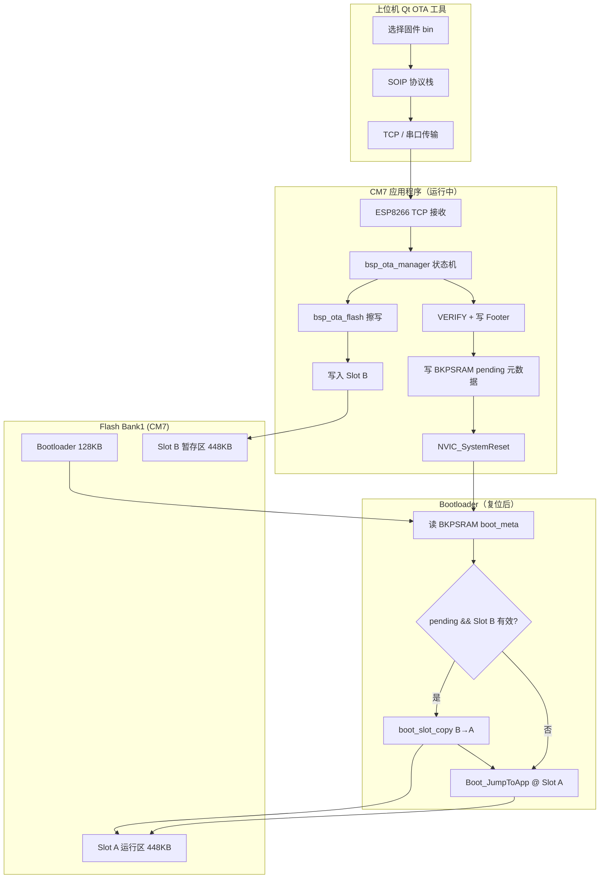
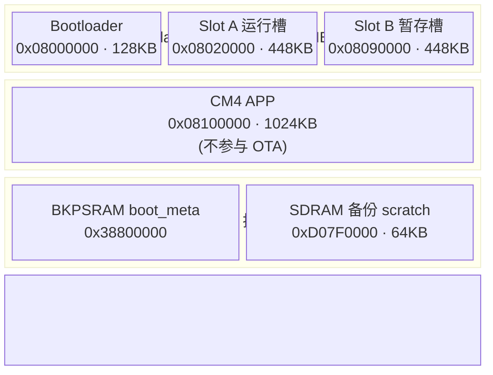
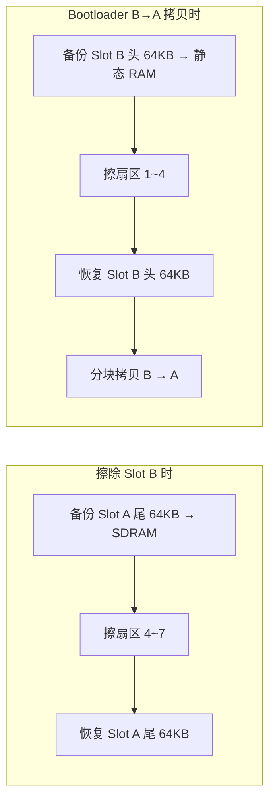
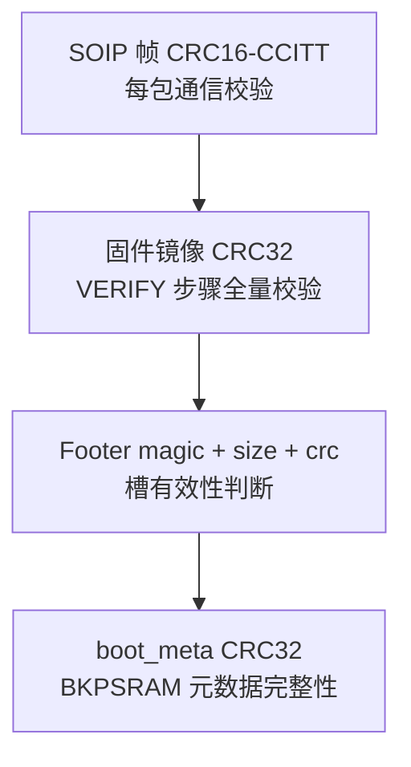
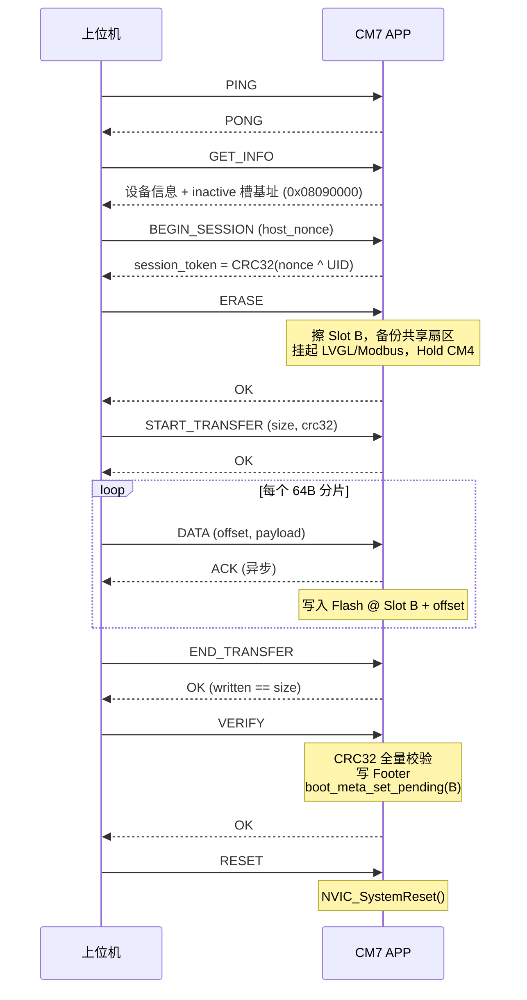
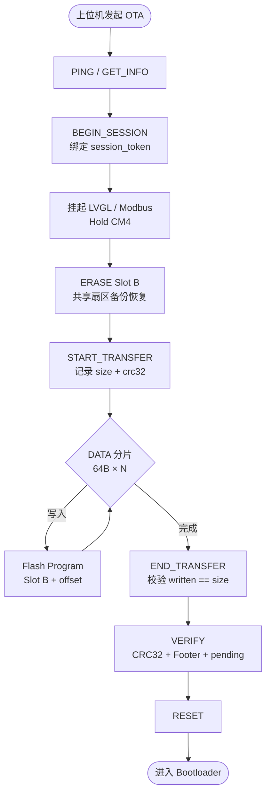
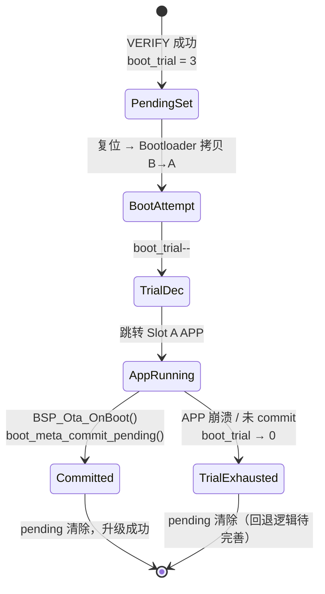
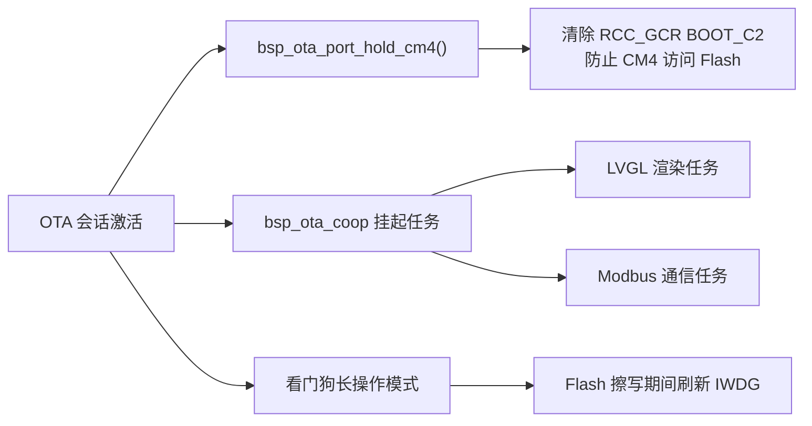

# STM32H747 OTA 设计流程教程

> 本文基于本仓库 `stm32h7-machine-controller` + `Bootloader` + `OTA` 上位机工具的实际实现编写，从 **Flash 分区设计** 出发，逐步讲解 A/B 双槽 OTA 的完整流程。

---

## 目录

1. [总体架构](#1-总体架构)
2. [Flash 分区设计（核心）](#2-flash-分区设计核心)
3. [元数据与镜像校验](#3-元数据与镜像校验)
4. [OTA 下载流程（APP 阶段）](#4-ota-下载流程app-阶段)
5. [Bootloader 激活流程（复位阶段）](#5-bootloader-激活流程复位阶段)
6. [试启动确认机制](#6-试启动确认机制)
7. [双核与协作注意事项](#7-双核与协作注意事项)
8. [工程文件对照表](#8-工程文件对照表)

---

## 1. 总体架构

本方案采用 **「A/B 双槽 + 拷贝到运行槽」** 的软件 OTA 架构，而非 STM32 硬件双 Bank 切换：

| 角色 | 说明 |
|------|------|
| **Slot A** | 唯一 **执行分区**，系统始终从这里启动 |
| **Slot B** | **暂存分区**，OTA 下载时写入非活动槽 |
| **Bootloader** | 仅负责 pending 检测、B→A 拷贝、跳转 APP |
| **APP (CM7)** | 负责 SOIP 协议通信、Flash 擦写、校验、写元数据 |
| **上位机 (Qt)** | SOIP v2 客户端，经 TCP/串口推送固件 |

### 1.1 端到端流程框架图



### 1.2 三阶段时序概览

```
┌─────────────┐     ┌──────────────┐     ┌─────────────────┐
│  阶段 A     │     │   阶段 B     │     │    阶段 C       │
│  APP 下载   │ ──► │ Bootloader   │ ──► │ APP 试启动确认  │
│  写 Slot B  │     │ 拷贝 B → A   │     │ commit pending  │
└─────────────┘     └──────────────┘     └─────────────────┘
      复位触发 ──────────────►
```

---

## 2. Flash 分区设计（核心）

分区设计是 OTA 的 **第一性原理**：所有后续逻辑（链接脚本、擦除策略、拷贝路径）都从这里推导。

### 2.1 芯片与 Bank 布局

目标芯片：**STM32H747**（双核 CM7 + CM4）

| Flash Bank | 基地址 | 容量 | 用途 |
|------------|--------|------|------|
| **Bank1** | `0x08000000` | 1 MB | CM7 Bootloader + CM7 APP (A/B) |
| **Bank2** | `0x08100000` | 1 MB | CM4 APP（本方案 **不参与 OTA**） |

### 2.2 CM7 Bank1 分区表

定义文件：`stm32h7-machine-controller/Common/Inc/boot_slot.h`

| 分区 | 基地址 | 大小 | 结束地址 | 说明 |
|------|--------|------|----------|------|
| **Bootloader** | `0x08000000` | 128 KB | `0x0801FFFF` | 扇区 0，独立链接 |
| **Slot A（运行槽）** | `0x08020000` | 448 KB | `0x0808FFFF` | 出厂烧录 & 唯一执行区 |
| **Slot B（暂存槽）** | `0x08090000` | 448 KB | `0x080FFFFF` | OTA 下载目标 |

```c
#define BOOTLOADER_FLASH_BASE   (0x08000000UL)
#define BOOTLOADER_FLASH_SIZE   (128U * 1024U)

#define CM7_APP_SLOT_SIZE       (448U * 1024U)
#define CM7_APP_SLOT_A_BASE     (0x08020000UL)   /* 运行槽 */
#define CM7_APP_SLOT_B_BASE     (0x08090000UL)   /* 暂存槽 */
```

### 2.3 Flash 扇区映射图

STM32H7 Bank1 每个扇区 **128 KB**。A/B 槽并非整扇区对齐，存在 **共享扇区**：

```
地址          扇区        归属
────────────────────────────────────────────────────────
0x08000000    Sector 0    ┌─ Bootloader (128KB)
0x08020000    Sector 1    │
0x08040000    Sector 2    ├─ Slot A 主体 (384KB = 扇区 1~3)
0x08060000    Sector 3    │
0x08080000    Sector 4    ├─ Slot A 尾 64KB ─┐
                            │                  │ 共享扇区 4 (128KB)
0x08090000                  └─ Slot B 头 64KB ─┘
0x080A0000    Sector 5    │
0x080C0000    Sector 6    ├─ Slot B 主体 (384KB = 扇区 5~7)
0x080E0000    Sector 7    │
0x08100000                ─── Bank1 结束 / Bank2 开始
```

**Slot A 组成**：扇区 1 + 2 + 3 + 扇区 4 的前 64 KB  
**Slot B 组成**：扇区 4 的后 64 KB + 扇区 5 + 6 + 7

> ⚠️ **设计要点**：擦除任一侧槽位时，共享扇区 4 会同时被擦除，必须 **先备份另一槽在共享区内的 64 KB 数据，擦完再写回**。这是本方案 Flash 操作最复杂的部分。

### 2.4 分区布局框架图



### 2.5 链接脚本与向量表偏移

| 镜像 | 链接脚本 | Flash ORIGIN | LENGTH |
|------|----------|--------------|--------|
| Bootloader | `Bootloader/Makefile/CM7/stm32h747xx_flash_CM7.ld` | `0x08000000` | 128K |
| CM7 APP | `stm32h7-machine-controller/Makefile/CM7/stm32h747xx_flash_CM7.ld` | `0x08020000` | 448K |
| CM4 APP | `stm32h7-machine-controller/Makefile/CM4/stm32h747xx_flash_CM4.ld` | `0x08100000` | 1024K |

CM7 APP 的 `SystemInit` 中设置：

```c
VECT_TAB_OFFSET = 0x00020000U;   /* 对应 Slot A 基址偏移 */
```

**重要**：Slot B **没有独立链接脚本**。OTA 镜像与 Slot A 使用 **同一份 bin**（链接到 `0x08020000`），下载时按 Slot B 基址偏移写入 Flash。

### 2.6 共享扇区擦除策略

配置：`BSP/OTA/bsp_ota_conf.h`

```c
#define BSP_OTA_SHARED_SECTOR_BASE  (0x08080000UL)   /* 扇区 4 */
#define BSP_OTA_SHARED_SECTOR_SIZE  (128U * 1024U)
#define BSP_OTA_SDRAM_BACKUP_ADDR   (0xD07F0000UL)   /* 64KB scratch */
```

| 场景 | 备份对象 | 备份位置 |
|------|----------|----------|
| APP 擦 Slot B | Slot A 在扇区 4 内的 64 KB | SDRAM `0xD07F0000` |
| Bootloader 擦 Slot A（B→A 拷贝前） | Slot B 在扇区 4 内的 64 KB | 静态 RAM `s_sector_backup[64KB]` |



---

## 3. 元数据与镜像校验

分区之外，OTA 还需要 **两层元数据** 和 **两级 CRC** 来保证完整性。

### 3.1 槽 Footer（Flash 尾部，每槽 32 字节）

```c
typedef struct __attribute__((packed)) {
    uint32_t magic;        /* 0x534F4F54 "SOOT" */
    uint32_t image_size;   /* 镜像有效长度 */
    uint32_t image_crc32;  /* 镜像 CRC32 */
    uint32_t version;      /* 版本号 */
    uint32_t reserved[4];
} boot_slot_footer_t;
```

- 位置：每个槽 **最后 32 字节**
- 写入时机：**VERIFY 成功后** 才写入（防止半成品被误判为有效镜像）
- 用途：Bootloader / APP 调用 `boot_slot_is_valid()` 判断槽是否可用

### 3.2 Boot 元数据（BKPSRAM，掉电保持）

```c
typedef struct {
    uint32_t magic;                              /* 0xB007B007 */
    uint32_t version;
    uint8_t  active_slot;                        /* 当前活动槽 */
    uint8_t  pending_slot;                       /* 待激活槽（通常为 B） */
    uint8_t  boot_trial;                         /* 试启动剩余次数，最大 3 */
    uint8_t  flags;                              /* BOOT_META_FLAG_PENDING */
    uint32_t slot_crc[CM7_APP_SLOT_COUNT];
    uint32_t slot_size[CM7_APP_SLOT_COUNT];
    uint32_t crc32;                              /* 结构体自身 CRC */
} boot_meta_t;
```

BKPSRAM 地址：`0x38800000`（备份域 SRAM，主电源掉电后由 VBAT 维持）

### 3.3 校验层次



| 层级 | 算法 | 作用范围 |
|------|------|----------|
| 通信帧 | CRC16-CCITT | 单个 SOIP 包 |
| 固件镜像 | CRC32 (IEEE) | 整包 bin |
| 槽 Footer | magic + CRC32 | Flash 槽有效性 |
| Boot Meta | CRC32 | BKPSRAM 结构体 |

> 当前方案 **无数字签名**，安全性依赖 CRC32 完整性校验。生产环境建议增加 ECDSA / RSA 验签。

---

## 4. OTA 下载流程（APP 阶段）

OTA 协议在 **运行中的 CM7 APP** 内执行，Bootloader 不参与通信。

### 4.1 通信链路

```
上位机 Qt ──TCP──► ESP8266 ──UART──► CM7 APP (bsp_ota_manager)
```

协议：**SOIP v2**（详见 `OTA/docs/PROTOCOL.md`）

### 4.2 设备端状态机

```
IDLE ──► SESSION ──► ERASING ──► RECEIVING ──► READY_VERIFY ──► IDLE
  ▲                                                                  │
  └──────────────────────── ABORT / 失败 ◄───────────────────────────┘
```

实现文件：`BSP/OTA/bsp_ota_manager.c`

### 4.3 SOIP 命令时序



### 4.4 各步骤详解

| 步骤 | 关键动作 | 代码入口 |
|------|----------|----------|
| **GET_INFO** | 返回 inactive 槽地址（运行 A 则返回 B） | `boot_slot_inactive_index()` |
| **BEGIN_SESSION** | 生成 session_token，选定目标槽 | `ota_device_token()` |
| **ERASE** | 擦目标槽 + 共享扇区保护 | `bsp_ota_flash_erase_slot()` |
| **DATA** | 64 字节分片写入 Flash | `bsp_ota_flash_program()` |
| **VERIFY** | CRC32 校验 → 写 Footer → 设 pending | `bsp_ota_flash_verify()` |
| **RESET** | 系统复位，进入 Bootloader | `NVIC_SystemReset()` |

### 4.5 下载阶段框架图



---

## 5. Bootloader 激活流程（复位阶段）

Bootloader 职责 **极简**：不做网络通信，只做 **pending 检测 → B→A 拷贝 → 跳转 Slot A**。

### 5.1 Bootloader 主流程

实现文件：`Bootloader/CM7/Core/Src/main.c`

```mermaid
flowchart TD
    Reset([系统复位]) --> Init[HAL_Init + 时钟 + UART]
    Init --> MetaLoad[boot_meta_load<br/>读 BKPSRAM]
    MetaLoad --> PendingCheck{flags & PENDING<br/>&& pending_slot == B<br/>&& Slot B valid?}

    PendingCheck -->|是| Copy[boot_slot_copy_to_run_slot(B)<br/>擦 A + 拷贝 B→A + 写 Footer]
    Copy --> CopyOK{拷贝成功?}
    CopyOK -->|否| ClearPending[清除 pending 标志]
    CopyOK -->|是| ValidCheck
    ClearPending --> ValidCheck

    PendingCheck -->|否| ValidCheck{Boot_IsAppValid<br/>Slot A?}

    ValidCheck -->|是| Trial[递减 boot_trial<br/>保存 meta]
    Trial --> Jump[Boot_JumpToApp<br/>@ 0x08020000]
    Jump --> App([CM7 APP 启动])

    ValidCheck -->|否| StayBoot[停留在 Bootloader<br/>打印诊断信息]
```

### 5.2 B→A 拷贝步骤

实现文件：`Bootloader/Common/Src/boot_slot_copy.c`

1. **备份** Slot B 在共享扇区 4 内的首 64 KB → 静态 RAM
2. **擦除** Slot A 区域（扇区 1~4）
3. **恢复** Slot B 首 64 KB
4. **分块拷贝**（256 B/chunk）Slot B → Slot A
5. **写入** Slot A 的 Footer

### 5.3 跳转 APP

`Boot_JumpToApp()` 执行：

1. 校验 Slot A 向量表（SP 在 RAM 范围，PC 在 Flash 范围）
2. 清理 NVIC 中断
3. **Hold CM4**（清除 `RCC_GCR_BOOT_C2`，防止 CM4 访问 Flash）
4. 写 `BOOT_JUMP_MAGIC` 到 `0x2001FFF0`（告知 APP 跳过二次 CM4 启动等待）
5. 设置 MSP，跳转到 Slot A 的 Reset_Handler

> **设计决策**：无论 meta 如何，**始终从 Slot A 启动**。Slot B 只是暂存，不是执行槽。

---

## 6. 试启动确认机制

OTA 拷贝完成后不能立即认为升级成功，需要 **试启动 + 确认** 机制防止坏镜像覆盖运行区。

### 6.1 试启动流程



| 阶段 | `boot_trial` | `flags` | 行为 |
|------|-------------|---------|------|
| VERIFY 后 | 3 | PENDING | 等待复位 |
| Bootloader 每次启动 | 递减 | PENDING | 最多试 3 次 |
| APP `BSP_Ota_OnBoot()` | — | 清除 PENDING | 确认升级成功 |

### 6.2 当前实现状态

- ✅ VERIFY 时 `boot_meta_set_pending(B, size, crc)`
- ✅ Bootloader 递减 `boot_trial`
- ✅ APP 启动时 `boot_meta_commit_pending()` 确认成功
- ⚠️ `boot_meta_on_boot_failure()` 已定义但 **未被调用**，完整自动回滚尚未闭环

---

## 7. 双核与协作注意事项

### 7.1 CM7 / CM4 分工

| 核心 | Flash 位置 | OTA 角色 |
|------|-----------|----------|
| **CM7** | Bank1 | OTA 全部逻辑 |
| **CM4** | Bank2 | 不参与 OTA，OTA 期间被 Hold |

### 7.2 OTA 期间资源协作



### 7.3 设计约束清单

- [ ] CM7 APP 体积 ≤ **448 KB**（Slot 大小上限）
- [ ] 链接地址必须是 **Slot A 基址** `0x08020000`
- [ ] 修改分区表需同步更新：链接脚本、`boot_slot.h`、擦除扇区范围
- [ ] 共享扇区 4 的 64 KB 备份缓冲区不可被其他模块占用
- [ ] OTA 期间避免 CM4 从 Flash 取指（Hold CM4）

---

## 8. 工程文件对照表

### 8.1 分区与启动

| 文件 | 职责 |
|------|------|
| `Common/Inc/boot_slot.h` | 分区地址、Footer 结构体 |
| `Common/Src/boot_slot.c` | 槽检测、有效性校验 |
| `Common/Inc/boot_meta.h` | BKPSRAM 元数据结构 |
| `Common/Src/boot_meta.c` | 元数据 load/save/pending/commit |
| `Common/Src/bsp_flash_ram.c` | DTCM RamFunc Flash 擦写 |

### 8.2 OTA 业务（APP）

| 文件 | 职责 |
|------|------|
| `BSP/OTA/bsp_ota_manager.c` | SOIP 状态机、命令调度 |
| `BSP/OTA/bsp_ota_protocol.c` | 帧组包/解析 |
| `BSP/OTA/bsp_ota_flash.c` | 槽擦写/校验/Footer |
| `BSP/OTA/bsp_ota_transport.c` | ESP8266 TCP 封装 |
| `BSP/OTA/bsp_ota_coop.c` | RTOS 任务挂起/恢复 |
| `BSP/OTA/bsp_ota_port.c` | CM4 Hold 控制 |
| `BSP/OTA/bsp_ota_app.c` | OTA 初始化、试启动确认 |

### 8.3 Bootloader

| 文件 | 职责 |
|------|------|
| `Bootloader/CM7/Core/Src/main.c` | pending 检测、拷贝触发、跳转 |
| `Bootloader/CM7/Core/Src/boot_jump.c` | APP 有效性检查、跳转 |
| `Bootloader/Common/Src/boot_slot_copy.c` | B→A 镜像拷贝 |

### 8.4 上位机

| 文件 | 职责 |
|------|------|
| `OTA/engine/UpdateEngine.cpp` | 升级状态机 |
| `OTA/protocol/OtaProtocol.cpp` | SOIP 协议 |
| `OTA/docs/PROTOCOL.md` | 协议规范 |

---

## 附录 A：从零设计 OTA 分区的步骤清单

如果你要在 **新项目** 中复用本方案，按以下顺序设计：

```
Step 1  确定 Flash 总容量与扇区大小（H7 = 128KB/扇区）
   │
Step 2  预留 Bootloader 分区（建议 128KB，占扇区 0）
   │
Step 3  计算 APP 最大体积，划分 A/B 两槽（本方案各 448KB）
   │
Step 4  检查 A/B 边界是否落在同一扇区内 → 设计共享扇区备份策略
   │
Step 5  编写 boot_slot.h 地址宏 + 链接脚本 ORIGIN/LENGTH
   │
Step 6  设计 Footer（Flash 尾部）+ boot_meta（BKPSRAM）
   │
Step 7  确定执行策略：swap（硬件双 Bank）或 copy-to-run（本方案）
   │
Step 8  实现 APP 侧下载 + Bootloader 侧激活 + 试启动确认
```

---

## 附录 B：常见问题

**Q: 为什么不直接从 Slot B 启动？**  
A: 简化链接脚本和向量表管理；Slot A 始终是已知启动地址，Bootloader 逻辑更可控。

**Q: 为什么不用硬件双 Bank Swap？**  
A: H7 双 Bank Swap 适合对称 A/B 执行，本方案选择「B 暂存 → A 执行」更灵活，Bootloader 可在拷贝前再次校验。

**Q: OTA 镜像需要重新链接到 Slot B 吗？**  
A: 不需要。同一份 bin（链接到 Slot A 地址）写入 Slot B，Bootloader 拷贝到 A 后地址一致。

**Q: 升级失败会怎样？**  
A: 若 APP 未能 commit pending，Bootloader 会在 3 次 trial 后清除 pending 标志；Slot A 仍保留上一次成功拷贝的镜像（前提是拷贝前 A 未被破坏）。

---

*文档版本：v1.0 · 对应仓库 OTA 实现 · SOIP v2.0*
